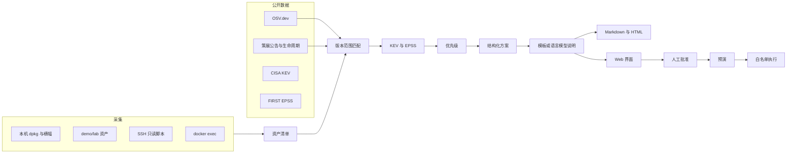

# VulnGuard 设计文档

## 1. 背景与目标

运行中的系统会同时带上操作系统包、Nginx / Redis / MySQL 这类中间件，以及 Python、npm、Maven、Go 的应用依赖。公开漏洞由安全研究人员和厂商持续发布。运维需要的是一份对照自己资产的更新建议，而不是另一份全球漏洞列表。

VulnGuard 做四件事：

- 摸清这套系统里实际安装了什么。
- 用公开漏洞数据判断哪些版本受影响。
- 用 CVSS、CISA KEV、EPSS 和暴露面排定处理顺序。
- 写出可复核的更新步骤，并在人批准之前保持只读。

成品以能演示为准。采集器、匹配和优先级有测试；界面能完成巡检、阅读依据、批准和预演。

## 2. 总体架构



运行时数据放在 SQLite（默认 `runtime/vulnguard.db`）。报告是文件，方便直接交给变更单。

## 3. 数据流

一次巡检的顺序是固定的。

1. 按来源采集资产。每条资产有名称、版本、生态、类型、位置、暴露面和原始证据。
2. 加载策展公告、生命周期和 OSV 快照。`--online` 时再请求 OSV、KEV 全文和 EPSS。
3. 用版本区间判断资产是否落入某条公告。同一 CVE 的 GHSA 与 GO/PYSEC 记录会合并，保留有 CVSS 的那条。
4. 用 KEV 和 EPSS 给每条发现打分，并按资产归并成更新方案。
5. 模板先写好说明。配置了 `VULNGUARD_LLM_API_KEY` 时，用技能文件里的约束再生成一版说明。模型文本不会变成要执行的命令。
6. 写入 Markdown、HTML、`findings.json` 和数据库。界面从数据库读取，批准和预演记在方案上。

## 4. 模块

| 模块 | 职责 |
| --- | --- |
| `inventory.py` | 解析 dpkg、中间件横幅、四种依赖清单；封装本机、fixture、Docker、SSH |
| `versioncmp.py` | Debian 版本、PyPI、以及带先行号的语义化版本 |
| `cvss.py` | CVSS v3.0 / v3.1 基础分 |
| `feeds.py` | 策展数据、OSV、KEV、EPSS 和离线快照 |
| `match.py` | 范围匹配，并跳过与本次中间件无关的普通系统包 |
| `priority.py` | 综合分和等级 |
| `remediate.py` | 方案、白名单、预演和执行 |
| `advise.py` | 模板说明，以及可选的聊天补全接口 |
| `report.py` / `web.py` | 报告和界面 |
| `pipeline.py` | 把上面串起来，并注明本机有没有 Trivy 等工具 |

## 5. 资产采集

演示环境 `demo/lab` 代表一台 Debian 10 业务机：

- `dpkg.tsv` 里有 `redis-server 5:5.0.7-2+deb10u1`，以及 bash、coreutils 这两个对照用的普通包。
- `middleware.txt` 是 `nginx -v`、`redis-server --version`、`mysql --version` 的输出。
- `app/` 下有四种依赖清单。清单只被读取，演示不安装这些旧包。

同一产品如果既有二进制横幅又有 Debian 包版本，保留 Debian 版本。这样 Redis 能带上 `5:5.0.7-2+deb10u1`，而不是只剩上游的 `5.0.7`。暴露面写在 `host.json`，例如对外的 nginx 和 log4j-core 记为互联网，数据库记为内网。

本机采集调用 `dpkg-query` 和中间件命令，并扫描指定目录里的清单。SSH 采集执行一段只读脚本，输出用分段标记解析，测试不需要真实主机。Docker 采集对每个运行中的容器执行版本命令、`dpkg-query` 和 `cat /opt/app/...`。官方镜像上的 Redis 保持 `generic` 生态，不会套用 Debian 特有公告。

普通系统包默认不逐个请求 OSV。bash、coreutils 会出现在资产清单里，用来说明采集范围比漏洞匹配范围更宽。全量发行版公告更适合交给 Trivy、Grype 或 Debian Security Tracker，见第 12 节。

## 6. 漏洞匹配

匹配分三层。

**策展公告**放在 `vulnguard/data/advisories.json`。每条都写了公开来源、CVSS、受影响范围和适用条件。这次核对过的包括：

- CVE-2021-23017，nginx 0.6.18 至 1.20.1 之前，NVD CVSS 7.7。F5 公告的分数是 3.7，详情里同时保留。
- CVE-2022-0543，只覆盖 Debian buster 与 bullseye 的修复版本，CVSS 10.0，在 KEV 中。
- CVE-2023-21980，MySQL 5.7.41 及更早的 5.7、8.0.32 及更早的 8.0，CVSS 7.1。
- CVE-2020-14343，PyYAML 5.4 之前，CVSS 9.8。
- CVE-2021-44228 与 CVE-2021-45046，log4j-core，都在 KEV 中。建议版本另有下限 2.17.1，在线数据若给出更高修复版本则采用更高者。
- CVE-2021-44906，minimist。

**生命周期**单独成条，编号以 `EOL-` 开头，使用维护风险分而不是冒充 CVSS。MySQL 5.7 的日期来自 Oracle 的支持公告（2023-10-25）。Redis 5.0 与 nginx 1.18 标为已离开上游维护分支。

**OSV.dev** 用 `POST /v1/query` 按生态、包名和版本查询。语言依赖的其余 CVE 来自这里。快照日期写在 `vulnguard/data/osv_snapshot.json`。同一 CVE 出现多条记录时，保留算出 CVSS 的那条，并合并别名和修复版本。Go 漏洞库经常给出一条没有 CVSS 向量的 `GO-` 记录，旁边的 GHSA 才有向量，合并就是为了避免把 7.5 分的问题显示成没有分数。

版本比较：

- Debian 包走 epoch、upstream、revision。`5:5.0.7-2+deb10u1` 小于 buster 修复版 `5:5.0.14-1+deb10u2`，bullseye 的 `5:6.0.16-1+deb11u2` 单独成段。
- PyPI 使用 `packaging`，因此 `5.4` 与 `5.4.0` 相等。
- 其他生态把连字符视作先行版本，使 `2.14.1` 大于 `2.0-beta9`，也使 Go 伪版本能按时间戳比较。

区间沿用 OSV 的语义：含 introduced，不含 fixed，含 last_affected。

## 7. 优先级

```text
综合分 = min(1, CVSS/10 + KEV×0.25 + EPSS×0.15) × 暴露面系数
```

暴露面系数：互联网 1.00，内网 0.85，仅本机 0.70。

等级：

| 综合分 | 等级 |
| --- | --- |
| ≥ 0.85 | 严重 |
| ≥ 0.60 | 高危 |
| ≥ 0.35 | 中危 |
| 其余 | 低危 |

附加规则：编号在 KEV 中且 CVSS 不低于 7 时，等级至少为严重。EPSS 没取到时，这一项不加分，说明里写「未取得」，避免把它说成发生概率为零。

演示数据里，Log4Shell（CVSS 10、KEV、EPSS 接近 1、互联网）得到 1.0000。Debian Redis 的 CVE-2022-0543 同样因 KEV 和 CVSS 10 落到严重，内网系数把它的综合分停在 0.85。nginx 的 CVE-2021-23017 基础分是 7.7，EPSS 在 2026-11-03 约为 0.53，又面向互联网，综合分刚好进入严重；详情同时写明只有配置了 `resolver` 才受影响，人可以据此下调紧急程度。

修复时限：严重建议 24 小时，高危 7 天，中危 30 天，低危进入常规窗口。KEV 条目带上 CISA 截止日期；样例里的日期都已经过去，说明会写成逾期后建议 24 小时内处理。

## 8. 更新建议与人机协同

一个资产的全部发现合成一份方案。修复版本的取法是：每条公告先取「高于现状的最低修复版本」，再在这些版本里取最大者，这样一次升级能盖住该资产的全部条目。Express 4.17.1 因此建议到 4.20.0，而不是跨到 5.0.0。log4j-core 若在线数据给出高于 2.17.1 的修复版本，采用那个更高版本，同时不低于 2.17.1。

大版本跳跃（例如 Jinja2 2.11 到 3.1）标成人工步骤。nginx 的目标写成「不低于 1.20.1 的现行 stable」，避免把 2021 年的 1.21.0 主线当成最终目标。MySQL 的目标是 8.4 LTS，因为 5.7 已经停止安全更新，只打到 5.7.42 并不能恢复支持。

界面上可以批准、驳回或接受风险。批准必须填写姓名、至少四个字的说明，并勾选已经核对回滚。这些记录进 SQLite。

## 9. 执行安全

模型只写给人看的说明。可执行参数由 `remediate.py` 生成，并在生成时做 SHA-256。执行前再次计算，摘要不一致就拒绝。

白名单只接受下面几类参数数组，并且使用 `subprocess` 的参数列表，不经过 shell：

- `apt-get install --only-upgrade <包名>`
- `apt-get install <包名>=<版本>`，供回滚说明和未来的钉版本使用
- `pip install <名称>==<版本>`
- `npm install <名称>@<版本>`

因此说明里即使出现 `curl ... | sh`，也不会被执行。没有批准、方案已驳回、或命令被改过，都会直接拒绝。

默认的「执行」在未设置 `VULNGUARD_ALLOW_APPLY=1` 时仍然只留下预演记录。预演本身不要求先批准，因为它不改系统。含有大版本迁移或构建清单修改的方案标记为 `manual`，即使打开执行开关也不会代跑。

## 10. 调度与报告

`vulnguard serve --interval-hours 24` 在进程内按小时间隔重复巡检。生产上也可以把 `vulnguard scan` 放进 cron。每次扫描都覆盖写入报告目录，数据库按扫描编号保留。

报告包含资产数、等级分布、数据源是在线还是快照、前若干条发现，以及每份方案的说明。HTML 报告可以单独打开，不依赖界面服务。

## 11. 演示环境

`demo/lab` 是默认可复现路径，样例报告用它在 2026-11-03 对在线数据源跑出来的。`itsdangerous==2.2.0`、bash 和 coreutils 出现在资产里，匹配结果中没有对应漏洞，用来对照「查过但没有命中」。

`docker-compose.yml` 提供另一条路径：旧的官方镜像加一个只暴露清单的应用容器。两条路径的差异写在 README 里，尤其是 CVE-2022-0543 不能用到官方 Redis 镜像。

## 12. 局限与后续

- 策展范围是这次演示会碰到的中间件和若干关键 CVE，不是全量 NVD。语言依赖的覆盖面取决于 OSV 查询和已提交的快照。
- 操作系统包没有逐包请求 OSV。发行版的 backport 需要 Debian/Ubuntu 安全追踪或 Grype、Trivy 的发行版库才能判断「包版本旧、补丁已打上」这种情况。
- CVE-2021-45046 的范围对 log4j 2.12 维护线偏宽。演示版本是 2.14.1，落在主线受影响区间里。
- CVE-2022-0543 的版本段按 Debian 安全追踪里的 buster 与 bullseye 修复版本编写，不自动外推到其他发行版。
- 在线 EPSS 和 KEV 会随日期变化，综合分也会变。快照把 2026-11-03 的结果固定下来。
- 自动执行只覆盖 apt/pip/npm 的窄升级。配置回滚、数据备份和服务编排仍由人完成。
- 没有做多租户、登录和真实变更窗口编排。

后续如果继续做，优先接上 Trivy 或 Grype 的 JSON 输出作为第二意见，并把 Debian Security Tracker 的固定版本做成和 OSV 一样的区间。执行侧则应该接到维护窗口和配置管理，而不是在生产主机上直接跑 `apt-get`。

## 参考的公开项目

链接和用途见 [ai-process/第三方开源仓库.md](../ai-process/第三方开源仓库.md)。本工具在这些数据源和版本算法之上自己实现了采集、排序、方案和批准流程，运行演示不需要先安装 Trivy。
